# fish-banners

Animated greeting banners for [fish](https://fishshell.com) in
[Ghostty](https://ghostty.org) and [kitty](https://sw.kovidgoyal.net/kitty/).
Every new terminal opens with the next generative animation in the cycle,
drawn as a real image in the terminal, and it clears itself away the moment
you run your first command.

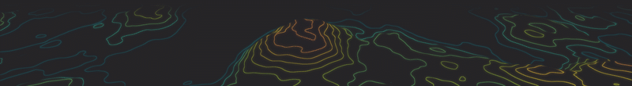

Seven banners, all coloured from the [0x96f](https://0x96f.dev) theme, each
looping seamlessly until you press Enter. New windows step through them in
turn, alphabetically, then start again:

| | |
|---|---|
| **Topography** — a fractal landscape in perspective, drawn as glowing contour lines coloured by height, flowing downhill. |  |
| **Ring Field** — wavy rings of pixel dust drifting outward from a dark centre, cooling from red to lavender as they travel. | 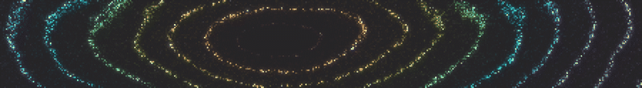 |
| **Contour Tide** — a pixelated ocean of particles rolling towards you, with bands of every theme colour riding in on the swell. | 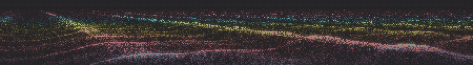 |
| **Terminal Rain** — streams of katakana raining down in two layers of depth, sweeping across the palette. | 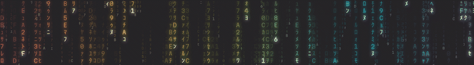 |
| **Glyph Ember** — ASCII fire licking up from a white-hot bed of glyphs, each flame its own colour, with sparks and smoke. |  |
| **Satin Ridges** — flowing satin folds catching soft highlights, drawn in symbols from `.` to `@`. | 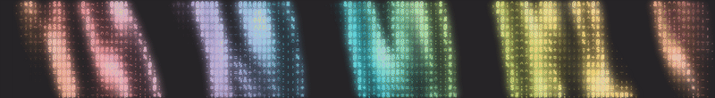 |
| **Watercolour** — pigment washes bleeding into each other, stippled in katakana and letters. | 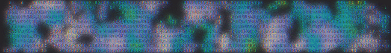 |

The GIFs are scaled down and limited to 256 colours. In the terminal the
banners render at your display's full resolution, in 24-bit colour, over a
transparent background.

## How it works

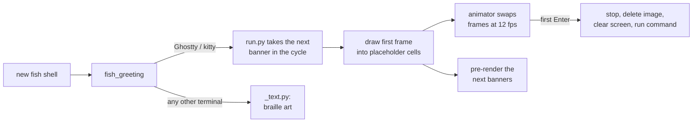

1. **Take the next banner.** When fish starts, `fish_greeting` runs
   `banners/run.py` through [uv](https://docs.astral.sh/uv/), which shows the
   banner after the one shown last, alphabetically, looping round. It
   remembers its place in `~/.cache/fish-banners/last`, under a lock, so
   windows opening at the same moment each get the next one in turn.
2. **Draw it as an image.** The frame is sent with the
   [Kitty graphics protocol](https://sw.kovidgoyal.net/kitty/graphics-protocol/),
   sized from the window's pixel dimensions, so it's crisp on any display. It's
   placed with *Unicode placeholders*: ordinary text cells that the terminal
   fills with the image, so the banner scrolls with your output like text.
   The background is transparent, so your terminal's own background and blur
   show through.
3. **Animate it.** A detached animator process replaces the image data
   behind the same image id 12 times a second, pointing the terminal at frame
   files on disk. It writes only graphics commands, never text, so it can't
   disturb your prompt or what you type. Every banner is designed to loop
   seamlessly: everything that moves completes a whole number of cycles per
   loop.
4. **Stay instant.** Rendering a banner's frames takes a few seconds, so
   each greeting plays one rendered earlier and, in the background, renders a
   replacement for every banner that needs one. Frames are cached per window
   size in `~/.cache/fish-banners/`. A lock keeps several windows opening at
   once from rendering the same banners twice. Playing a cached banner takes
   about 80 ms.
5. **Get out of the way.** The greeting takes over the Enter key once. Your
   first Enter stops the animator, deletes the image, clears the screen, then
   hands the keypress back to whatever Enter did before, so your command runs
   at the top of a clean screen. The animation also stops after 10 minutes,
   or when the window closes.
6. **Fall back gracefully.** In terminals without the graphics protocol (or
   inside tmux, which blocks it), `banners/_text.py` prints a still
   topography in coloured braille characters instead. It needs nothing but
   the macOS system Python.

## Requirements

- **macOS.** The glyph banners use macOS system fonts; see
  [Fonts](#fonts).
- **Ghostty or kitty** for the image banners. Other terminals get the text
  fallback.
- **fish** 4.0 or later (for its named key bindings).
- **[uv](https://docs.astral.sh/uv/)** (`brew install uv`). It runs
  `run.py` with its dependencies (numpy, Pillow) declared inline, installing
  them on first use. The first greeting after installing takes a few seconds
  longer while that happens.

## Install

```fish
git clone https://github.com/zmscode/fish-banners ~/Code/fish-banners
~/Code/fish-banners/install.fish
```

The installer symlinks `banners/` and `functions/fish_greeting.fish` into
your fish config, so `git pull` updates them. Use `--copy` to copy instead.
Anything already in the way is moved aside, not deleted.

To hide macOS's `Last login: …` line above the banner:

```fish
touch ~/.hushlogin
```

Open a new Ghostty or kitty window. The very first banner renders while you
wait (a second or two). After that, banners are pre-rendered and appear
instantly.

## Options

Every banner is one Python file in `banners/`, with its settings as
constants at the top. After changing one, delete that banner's cache so new
frames are rendered:

```fish
rm -rf ~/.cache/fish-banners/<banner>
```

### Every banner

| Setting | Meaning |
|---|---|
| `FRAMES` | Frames per loop. At 12 fps, 36 frames is a 3 second loop. |
| `POST` | Post-processing effects to apply, in order. See [Effects](#effects). |
| colour stops | Named per banner (`STOPS`, `FLAME`, `WATER`, `SHEEN`, `PIGMENTS`…): positions 0–1 mapped to RGB colours. All use the 0x96f palette. |

### Per banner

| Banner | Settings |
|---|---|
| `topography` | `LEVELS` contour lines from plain to peak · `SEA` how much land is flooded flat · `AMP` peak height |
| `rings` | `PIXEL` dust pixel size · `DENSITY` particles per pixel · `RINGS_TO_LAVENDER` how far rings travel through the palette |
| `tide` | `PIXEL` · `DENSITY` · `HORIZON` horizon height · `CHOP` how sharply crests peak · `BANDS` palette repeats from shore to horizon |
| `rain` | `TRAIL` glyphs per trail · `GLYPHS` the characters that fall |
| `ember` | `HEIGHT` flame height · `WIND` sideways lean · `CHARSET` density ramp · `SPARKS` spark glyphs |
| `satin` | `ANGLE` fold direction · `FOLDS` folds across the banner · `GLOSS` highlight sharpness · `ROWS` symbol size · `CHARSET` density ramp |
| `watercolour` | `SCALE` washes per banner height · `WARP` how much the paint swirls · `DRIFT` flow per loop · `ROWS` glyph size · `GLYPHS` · `LEVELS` density steps |

Character ramps (`CHARSET`, `GLYPHS`) are sorted by how much ink each glyph
uses, so any set of characters works, in any order.

### Global

| Where | Setting |
|---|---|
| `functions/fish_greeting.fish` | Banner height: the `10` passed to `run.py` (rows of terminal cells), and the `12` passed to `_text.py`. |
| `banners/run.py` | `FPS` (12) · `MAX_SECONDS` before the animation stops on its own (600) |

### Fonts

Glyph banners draw characters with the first font in `FONTS`
(`banners/_common.py`) that has each glyph: Martian Mono Nerd Font first,
then Hiragino (for katakana), Apple Symbols, Geneva and Menlo. Change the
list to use your own terminal font. Missing fonts are skipped.

## Effects

Add effects to a banner with `POST`. They run in order, so for example:

```python
POST = ["trails", "chromatic", "bloom", "grain"]  # watercolour
```

lets the trails pick up the colour fringes, then glows everything, then
grains the result. Currently `watercolour`, `satin` (`trails`,
`soft-focus`) and `tide` (`scanlines`) use effects.

| Effect | | Effect | |
|---|---|---|---|
| none |  | `bloom` — a wide, soft halo around everything bright | 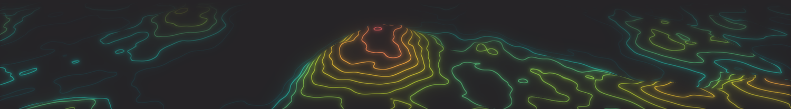 |
| `chromatic` — red and blue fringes pulled apart, like a cheap lens | 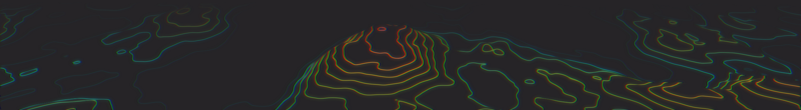 | `scanlines` — CRT scanlines with a soft vignette | 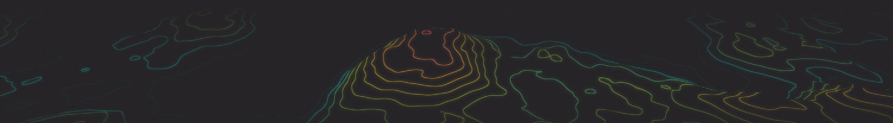 |
| `grain` — animated film grain | 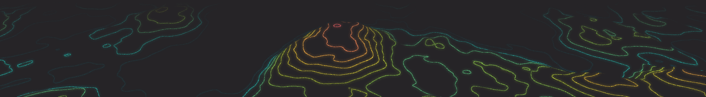 | `tilt-shift` — a sharp band through the middle, blurred above and below | 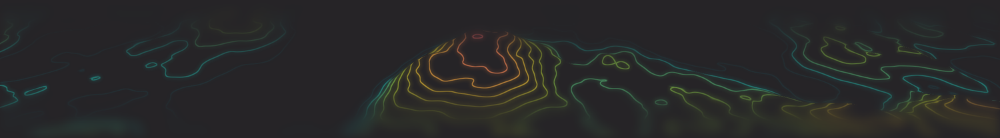 |
| `dither` — ordered dithering down to the 0x96f palette, in chunky pixels | 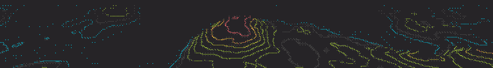 | `glitch` — slices of the frame jolting sideways, changing every few frames | 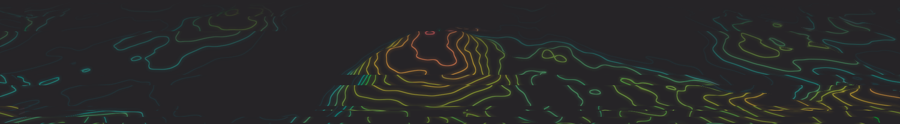 |
| `soft-focus` — a dreamy haze from blending in a blurred copy | 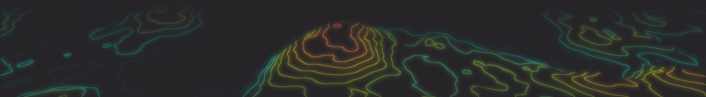 | `halftone` — print-style dots sized by brightness | 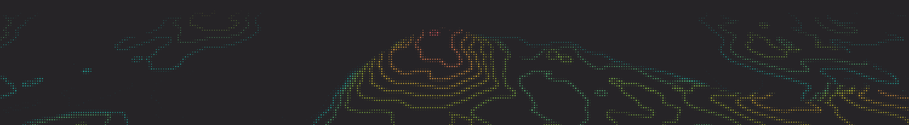 |
| `trails` — earlier frames linger and fade behind moving things | 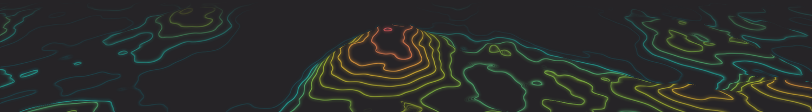 | | |

`trails` looks back over the last few frames. To keep the loop seamless,
the runner first renders the end of the loop, so frame 0 already has the
trail from the frames before it.

Effects live in `banners/_post.py`: a function `(rgba_frame, phase) -> rgba_frame`
added to `EFFECTS`, or `(recent_frames, phase) -> rgba_frame` added to
`HISTORY` with how many frames it needs.

## Writing a banner

Add a file to `banners/` (names starting with `_` are support code and are
never shown). It joins the cycle automatically. A banner is a module with:

```python
from dataclasses import dataclass

import numpy as np
from _common import Array, rgba

FRAMES = 36                  # frames per loop (optional, default 36)
POST = ["bloom"]             # effects (optional)


@dataclass
class State:
    """Everything that stays fixed while the banner animates."""

    glow: Array


def prepare(W: int, H: int, seed: int) -> State:
    """Slow, once per landscape: W×H is the image size in pixels."""
    rng = np.random.default_rng(seed)
    return State(glow=rng.random((H, W), dtype=np.float32))


def frame(S: State, phase: float) -> Array:
    """Fast, once per frame: phase runs 0 → 1 over the loop.
    Return H×W×4 uint8 RGBA with straight alpha."""
    pulse = 0.5 + 0.5 * np.cos(2 * np.pi * phase)   # whole cycles loop seamlessly
    colour = np.broadcast_to(np.array([0x00, 0xCD, 0xE8], np.float32), (*S.glow.shape, 3))
    return rgba(colour, S.glow * pulse)
```

For a seamless loop, anything driven by `phase` must complete a whole
number of cycles between phase 0 and phase 1.

`banners/_common.py` has the building blocks the existing banners use:

| Helper | Does |
|---|---|
| `fbm_noise(rng)` | smooth fractal value noise |
| `blur(img, r)` | fast approximate gaussian blur |
| `gradient(t, stops)` | map values through colour stops |
| `rgba(rgb, alpha)` | pack float colour and coverage into a frame |
| `glyph_atlas(chars, gw, gh)` | rasterise characters into masks, with font fallback |
| `stamp(atlas, idx, colour, inten)` | compose a grid of glyphs into an image |
| `splat(x, y, inten, colour, W, H)` | accumulate particles, smooth or pixel-crisp |
| `pixelate(img, scale, W, H)` | blow a low-resolution frame up by whole pixels |

## Files

```
functions/fish_greeting.fish   greeting: shows a banner, clears it on first Enter
banners/run.py                 cycles, caches, draws and animates banners
banners/_common.py             noise, blur, colour, glyph and particle helpers
banners/_post.py               post-processing effects
banners/_text.py               text fallback for other terminals
banners/<name>.py              the banners
banners/pyproject.toml         development tooling (types, lint, format)
install.fish                   links or copies everything into your fish config
```

## Development

The banner code is fully typed and checked with
[basedpyright](https://docs.basedpyright.com) in strict mode, and linted and
formatted with [Ruff](https://docs.astral.sh/ruff/):

```fish
cd banners
uv sync                 # a .venv with numpy, Pillow and the tools
uv run basedpyright
uv run ruff check
uv run ruff format
```

Strict mode has one rule relaxed, `reportUnknownMemberType`, because
numpy's own type stubs leave parts of some functions unknown. `_text.py` is
held to Python 3.9 so it runs on macOS's system Python.

## Troubleshooting

- **No banner, just braille text:** you're not in Ghostty or kitty, you're
  inside tmux, or `run.py` failed. Check that `uv` is on your `PATH` in fish.
- **What happened to an animation:** `~/.cache/fish-banners/log.txt` records
  why each one stopped (dismissed, window closed, timed out) and any errors.
- **Start fresh:** `rm -rf ~/.cache/fish-banners`. The next window renders
  a banner while you wait, then refills the cache in the background.
- **Changing window size** renders new frames for the new size. Old sizes'
  frames stay cached (roughly 30–120 MB per banner per size); delete the
  cache to reclaim the space.

## Credits

The banners are original implementations inspired by
[React Bits](https://reactbits.dev) components:
[Topography](https://www.reactbits.dev/backgrounds/topography),
[Ring Field](https://pro.reactbits.dev/docs/components/ring-field),
[Contour Tide](https://pro.reactbits.dev/docs/components/contour-tide),
[Terminal Rain](https://pro.reactbits.dev/docs/components/terminal-rain),
[Glyph Ember](https://pro.reactbits.dev/docs/components/glyph-ember),
[Satin Ridges](https://pro.reactbits.dev/docs/components/satin-ridges) and
[Watercolor](https://pro.reactbits.dev/docs/components/watercolor).
Colours from the [0x96f](https://0x96f.dev) theme.

[MIT licensed](LICENSE).
